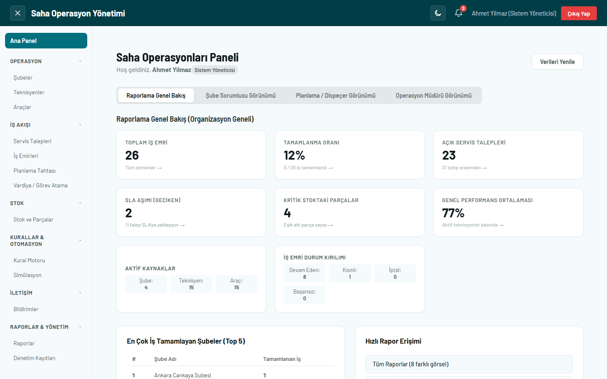
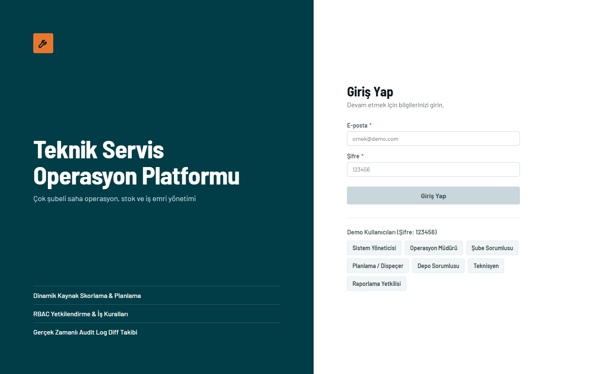
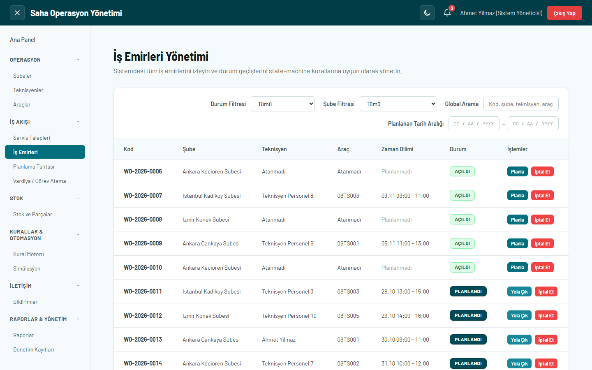
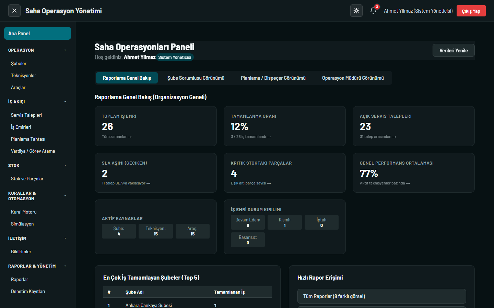

# Teknik Servis Operasyon Platformu

Çok şubeli bir teknik servis firmasının saha operasyonunu yöneten Angular uygulaması: servis talepleri, iş emirleri, teknisyen ve araç planlama, stok rezervasyonu, kural motoru, raporlar.

**Canlı demo:** https://teknik-servis-platformu.vercel.app
Giriş ekranındaki demo kullanıcılarından birini seçmek yeterli (ortak şifre `123456`).




| Giriş | İş emirleri | Koyu tema |
|---|---|---|
|  |  |  |

## Öne çıkanlar

- **İş emri durum makinesi:** Durumlar yalnızca izinli yollarla değişir (`OPENED → PLANNED → ON_THE_WAY → ON_SITE → COMPLETED`). Geçersiz bir geçiş reddedilir ve denetim kaydına yazılır.
- **Çakışma önleme:** Bir teknisyen ya da araç aynı anda iki aktif işe atanamaz. Biten veya iptal edilen işler zaman dilimini serbest bırakır.
- **Stok rezervasyonu:** Planlanan işin parçaları stoktan düşülmez, rezerve edilir. Kullanılabilir stok `stockQuantity - reservedQuantity` ile hesaplanır. İptalde rezervasyon bırakılır, kısmi tamamlamada yalnızca kullanılan parça düşer.
- **Kaynak puanlama:** Teknisyen ve araçlar 100 puan üzerinden sıralanır. Yetkinlik uyumu, yakınlık, müsaitlik ve iş yükü gibi kriterlerin katkısı ekranda görünür.
- **Kural motoru:** Çelişen kurallar her seferinde aynı şekilde çözülür: önce düşük `priority`, eşitse eski kural kazanır. Kaybeden kural denetim kaydına yazılır.
- **Rol bazlı yetki:** 7 rol vardır. Yetki hem rota koruyucularında hem servis metotlarında (`assertPermission`) denetlenir.
- **Dayanıklı depolama:** Bozuk `localStorage` verisi uygulamayı düşürmez, yedeklenip koleksiyon sıfırlanır. Kota aşımı yakalanır.
- **Simülasyon ekranı:** SLA gecikmesi, çakışma, bozuk veri ve 5.000+ kayıt gibi senaryolar tek tıkla denenebilir.

## Teknolojiler

Angular 22 (standalone bileşenler, Signals, Reactive Forms, lazy loading) · TypeScript · SCSS · Chart.js · Vitest · GitHub Actions · Vercel

## Mimari

```
src/app/
├── core/       # Servisler, iş kuralları, yetki, modeller, depolama
├── features/   # Sayfa bazlı, lazy loaded özellik modülleri
├── layout/     # Uygulama iskeleti
└── shared/     # Ortak bileşenler, direktifler, pipe ve doğrulayıcılar
```

Bileşenler yalnızca arayüzden sorumludur. İş kuralları ve yetki denetimi servislerde, veri erişimi `StorageService` içindedir. Bu sayede ileride backend'e geçmek için bileşenleri değil, veri katmanını değiştirmek gerekir.

## Çalıştırma

```bash
npm install
npm start        # http://localhost:4200
npm run build    # üretim derlemesi
npm test         # testler (izleme modunda)
npm run test:ci  # testler (tek sefer)
```

## Testler

83 birim testi vardır ve her push'ta CI'da build ile birlikte çalışır. Kapsananlar: iş emri durum geçişleri, kod üretimi, iptal ve geri alma, zaman çakışması, kural çakışması çözümü, stok rezervasyonu, şubeler arası transfer, sayısal form alanları, rol yetkileri ve kapsamı, silme korumaları, izin kontrolü. Diğer servisler ve arayüz akışları henüz otomatik test kapsamında değildir.

## Bilinen sınırlar

Bu proje bilinçli olarak yalnızca tarayıcıda çalışır, backend yoktur:

- Veriler tarayıcının `localStorage` alanında tutulur, kullanıcılar arasında paylaşılmaz.
- Giriş bir demodur: şifreler istemci tarafında kontrol edilir, gerçek bir güvenlik sınırı oluşturmaz.
- Eşzamanlı işlem yoktur. Gerçek kullanımda rezervasyon kontrolleri sunucu tarafına taşınmalıdır.
- Yakınlık puanı gerçek mesafe değil, şube ve bölge bilgisine dayalı bir yaklaşımdır.
